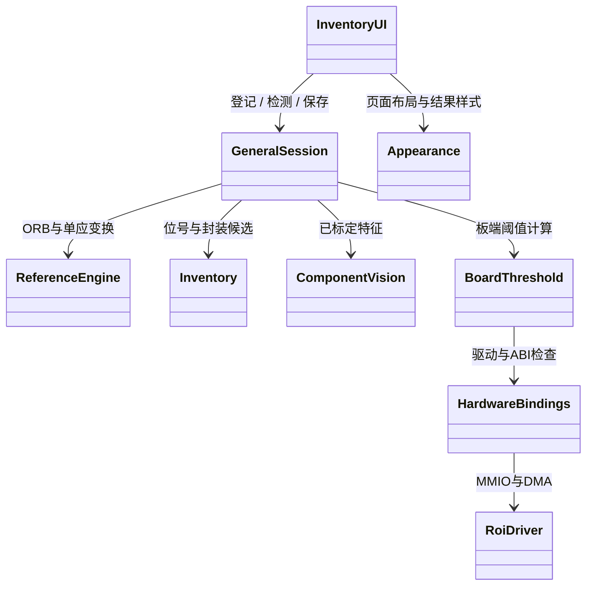
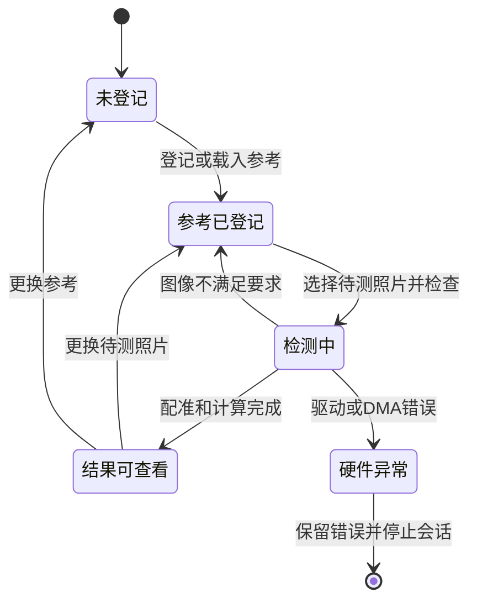

# 程序实现与数据流

## 模块调用关系

## 参考登记

`GeneralSession.register` 先提取参考照片特征。对于现有板型，将参考图谱变换到本次登记照片；对于新板型，读取位号候选并寻找邻近封装。候选不能替代人工确认，因此每项分别保存位号、封装框、是否装件、是否参与检测和是否已经核对。

## 检测过程

`ReferenceEngine.align` 使用特征匹配与单应矩阵将待测照片变换到参考坐标。程序检查有效匹配数、内点比例、空间覆盖和重投影误差，不能可靠对齐时直接拒绝该照片。

随后按参考清单取出元件区域，归一化为64×64的小图。通用判断使用封装分割占比、轮廓和主轴方向；已有标定项使用对应特征模型。U类器件主体存在与极性方向分别输出。程序使用灰度、颜色和梯度特征，不将整幅照片的逐像素差异直接当作缺件。

## 数据与接口

| 数据 | 格式 | 用途 |
|---|---|---|
| 上传照片 | JPG / PNG，最大12MB、2000万像素 | 原始输入 |
| 解码照片 | uint8，BGR，H×W×3 | ARM视觉处理 |
| 器件小图 | 64×64 | 封装特征 |
| DMA输入 | uint8，连续二维灰度拼图 | FPGA阈值计算 |
| DMA输出 | 同尺寸uint8，值为0或255 | 二值特征 |
| 清单 | JSON | 位号、区域、装件及核对状态 |
| 结果 | JSON / CSV / PNG / NPY | 复核和追溯 |

## 状态处理

## 计算分工

目前 FPGA 承担灰度阈值和ROI流处理，配准、OCR、形状与方向判定由 Python 完成。此架构不是整套视觉算法全部在 FPGA 上执行。论文或比赛材料应按照实际分工描述硬件加速范围。
