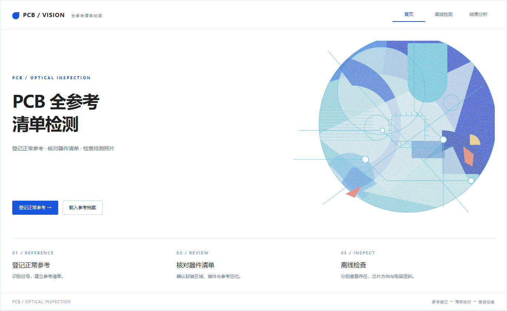
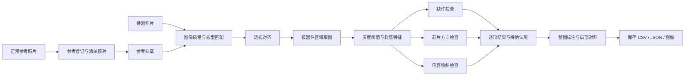
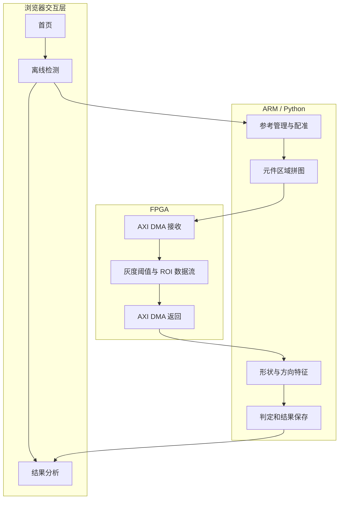
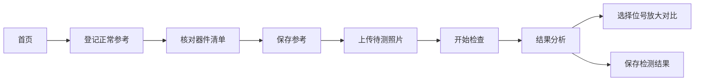
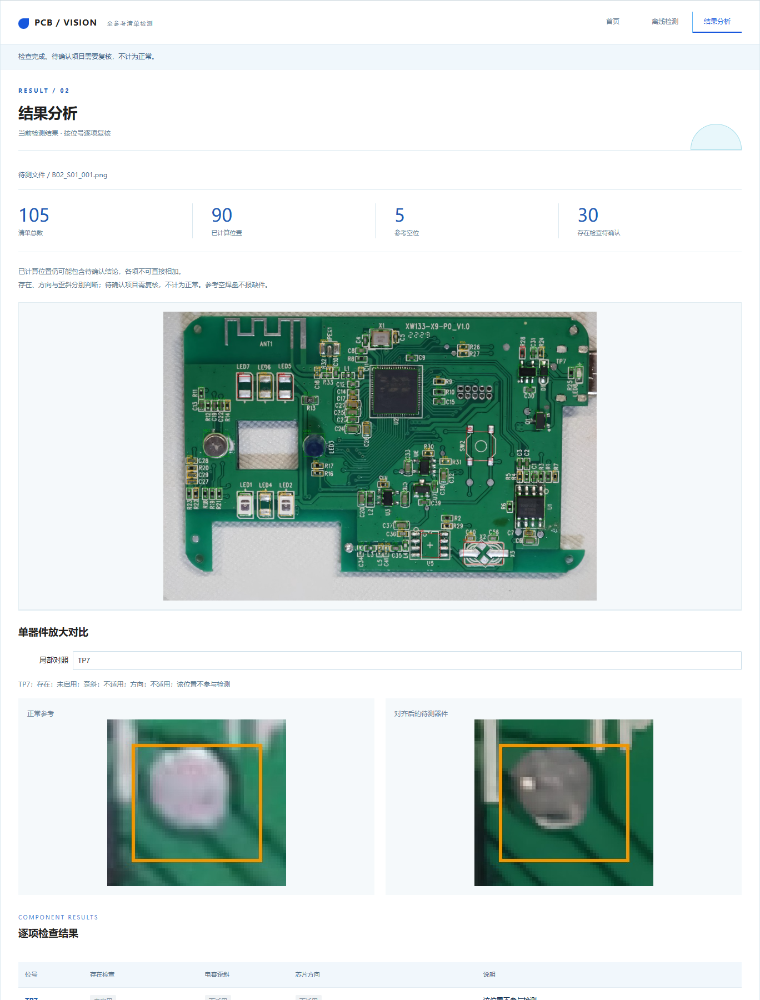

# PCB Defect Detection

## 基于参考板的 PCB 装配缺陷检测系统

本项目面向 PCB 装配检查，通过正常参考板建立器件清单，对同型号待测板完成图像对齐和逐项检查。系统采用蓝色 Jupyter 交互界面，支持参考登记、器件清单编辑、检测结果展示、单器件放大对比及结果保存。PYNQ-Z2 模式通过 AXI DMA 调用 FPGA 灰度阈值处理模块，ARM 端完成图像配准、特征分析与结果判定。

项目由原 PCB_ROI_Fpga 仓库及后续软硬件联调版本整理而来。当前仓库收录可运行程序、模型、示例数据、硬件交付文件及复现步骤。项目来源见 [来源记录](docs/provenance.json)。



## 1. 项目功能与范围

| 功能 | 实现方式 | 当前范围 |
|---|---|---|
| 图像对齐 | ORB 特征匹配、RANSAC 单应变换 | 同型号、同一面、细节清晰的平面照片 |
| 器件清单 | 已有参考图谱匹配，或 OCR 候选位号与人工核对 | 参考登记后保存，可补充、修改位号和封装区域 |
| 缺件检查 | 封装主体、形状及已标定特征 | 遍历清单；无法可靠判定时保留待确认 |
| 芯片方向 | 极性标记及参考方向特征 | U1/U5 有真实开发样本，其他封装属于扩展规则 |
| 电容歪斜 | 轮廓长轴及已标定形状 | C14/C17 有真实开发样本，其他位置需要复核 |
| 局部对比 | 相同参考坐标裁剪、相同放大比例 | 正常参考与对齐后的待测器件并排显示 |
| 结果保存 | CSV、JSON、对齐图和实际阈值输出 | CPU 与 FPGA 路径分别记录 |

提供的参考图谱包含105个可见标识位置，其中90个已登记装件位置进入计算、5个参考空位、2个测试点或天线标识，以及8个待核对位置。该数字来自当前参考清单，不代表制造商 BOM，也不代表105个已装器件或105项已经通过验证的检测能力。

新板型需要先建立并核对参考清单。系统不能仅凭一张不清晰的照片保证读全所有位号，也不能从没有可见方向依据的对称封装可靠判断焊反。翘起高度、电气功能和焊点内部质量不在本项目当前检查范围内。

## 2. 整体实现





电脑复现模式使用 CPU 计算阈值，不调用 FPGA。板端模式通过 `backend.py` 调用随仓库提供的驱动，真实返回的阈值图参与特征计算。发生硬件异常时停止该会话，不自动改用 CPU 掩盖故障。

## 3. 仓库结构

```text
PCB_Defect_Detection/
├── src/pcb_app/              当前检测程序和蓝色界面
│   ├── ui.py                界面回调、结果显示与保存
│   ├── appearance.py        三页布局、样式和内嵌插画
│   ├── general.py           参考档案、配准与全清单检测
│   ├── inventory.py         位号识别和封装候选提取
│   ├── backend.py           FPGA 阈值处理接口
│   ├── legacy.py            已标定特征及配准公共实现
│   └── assets/              图谱、模型和参考图片
├── notebooks/               PC / PYNQ 两个轻量入口
├── hardware/                原硬件交付版本、驱动、RTL和发布文件
├── data/                    正常参考及开发照片
├── configs/                 OCR 连接配置示例
├── scripts/                 快速复现检查
├── tests/                   当前软件流程测试
├── docs/                    部署、实现、验证及来源说明
├── research/baseline/       原仓库算法基线及开发标签
├── .github/workflows/       Windows / Ubuntu 软件检查
├── ocr_service.py           新板型参考位号识别服务
└── pyproject.toml           Python 项目与依赖配置
```

`src/pcb_app` 是当前应用入口。`research/baseline` 保留原项目算法和开发记录，供比较与追溯，不作为蓝色界面的启动目录。旧版参考位号、阈值和结果不能直接当作新版全清单的验证成绩。

## 4. 在另一台电脑上复现

推荐使用64位 Python 3.11。Windows、Linux 和 macOS 可先运行 PC 模式；无需 FPGA 即可复现提供的开发照片检测流程。依赖安装需要网络连接，运行已包含的参考图谱不需要在线图片、字体或外部网页资源。

下载仓库后，在仓库根目录打开终端。Windows 执行：

```powershell
python -m venv .venv
.venv\Scripts\python.exe -m pip install -e ".[test]"
.venv\Scripts\python.exe scripts/smoke_test.py
.venv\Scripts\python.exe -m pytest -q
.venv\Scripts\python.exe -m notebook
```

Linux 或 macOS 将 `.venv\Scripts\python.exe` 换成 `.venv/bin/python`。在 Jupyter 中打开 `notebooks/pcb_pc.ipynb`，运行唯一代码格，即可显示蓝色界面。

选择 `data/reference/b01_reference.png` 登记参考，然后上传 `data/development/s01/b02_s01_001.png`。该示例应输出完整参考清单，并在已标定范围内报告 U5、X2、SW2、LED5、LED7 缺件。其他位置可能显示待确认，不能将这些项目计为正常。示例照片已经参与开发，因此这一步属于复现检查，不是独立准确率评测。

## 5. 界面操作



正常参考应由使用者确认装配和方向正确。首次登记时核对器件位号、封装坐标和是否装件，参考空焊盘应标记为空位。待测照片不需要重新标注，程序根据保存的参考清单自动对齐并逐项检查。照片要求只在参考登记区显示。

“存在”只表示对应区域有封装主体，不代表方向、电气和焊接质量全部合格。芯片文字或极性标记不清时，方向可以单独显示待确认。统计中的“已计算”和“待确认”可能重叠，不能直接相加计算良率。



## 6. PYNQ-Z2 部署

复制整个仓库到板上，例如 `/home/xilinx/jupyter_notebooks/PCB_Defect_Detection`。保持目录结构完整，使用板卡已有的 PYNQ、OpenCV、NumPy 和 ipywidgets 环境，打开 `notebooks/pcb_board.ipynb` 并运行。不要在 ARMv7 板上直接执行 PC 的整套依赖安装。

板端入口自动将硬件根目录指向仓库的 `hardware`，所需文件为：

```text
hardware/
├── pcb_b_roi_v03/
│   ├── release/roi_v0_3/pcb_roi.bit
│   ├── release/roi_v0_3/pcb_roi.hwh
│   └── software/roi_driver.py、transport.py
└── pcb_b_closure_v032/
    └── software/final_roi_api.py、aoi_roi_service.py
```

驱动要求 ABI 3，并检查忙状态和错误状态。输入为按器件取出的灰度拼图，使用单个 ROI 传输，因此清单数量不受原17个 ROI 数量的直接限制。原始照片尺寸不直接等于 DMA 输入尺寸。

使用前停止其他检测 Notebook 的内核，避免多个程序同时访问 DMA。首次上板依次核对：界面启动、参考登记、B02 缺件、B05 焊反、B06 歪斜、结果保存。新 UI 的实际板端验收仍需执行，不能用原硬件版本的验收记录替代。

## 7. 新板型与 OCR

当前图谱能匹配提供的同型号参考；其他板型需要 OCR 生成候选位号，再核对封装区域。电脑安装 `python -m pip install -e ".[ocr]"` 后，可在 PC 模式直接使用本地 OCR。

PYNQ ARMv7 尚未验证 ONNX Runtime 安装，板端通过同一局域网内的电脑运行 OCR 服务。复制 `configs` 中两个示例文件，设置电脑实际 IP 和相同的随机令牌。服务端运行：

```text
python ocr_service.py --config ocr_service_config.json
```

板端连接文件命名为 `pcb_ocr_connection.json`，放到 `hardware` 目录，因为该目录是板端会话根目录。配置中的地址必须是服务电脑实际可访问的局域网地址，不能照抄开发机器的旧 IP。服务只在新参考登记时接收参考照片，后续检测使用板上已保存的档案。私人连接配置与令牌不要提交到 GitHub。

## 8. 验证与复现边界

软件检查覆盖参考登记、完整清单输出、示例缺件、参考恢复、UI 局部对比等流程。`.github/workflows/ci.yml` 配置了 Windows 与 Ubuntu 检查，但配置存在不代表远程 CI 已通过。实际本机检查结果见 [验证记录](docs/validation.md)。

原硬件交付中的仿真和上板记录保留在硬件目录，其结论只适用于对应版本。当前全部示例属于开发数据，不作为比赛的独立准确率。比赛评测应另采集未用于调参的照片，人工标记真实缺陷，并分别统计漏检、误报和待确认项。

## 9. 常见问题

| 现象 | 检查方法 |
|---|---|
| 只显示 VBox 文字 | 强制刷新浏览器，确认 ipywidgets 前端正常，再重新显示界面 |
| 打开页面很卡 | 使用本仓库短入口，不要将模型 Base64 填入 Notebook 代码格 |
| 对齐失败 | 检查同型号、同一面、照片完整度和小元件细节 |
| 参考清单有误 | 在参考登记阶段改名、修正封装框或补充器件，再保存档案 |
| 缺少硬件文件 | 检查整个 hardware 目录是否完整复制，以及是否下载到真实二进制文件 |
| FPGA 状态异常 | 停止检测并保存错误，不要反复点击或同时启动另一检测程序 |
| 换电脑后 OCR 不通 | 修改实际局域网 IP、令牌，检查服务进程和网络可达性 |

## 10. 项目来源与使用说明

原始项目：[SourceVv/PCB_ROI_Fpga](https://github.com/SourceVv/PCB_ROI_Fpga)。硬件版本提交号与最终 UI 来源记录在 `docs/provenance.json`。本仓库未代原作者选择开源许可证；公开发布前应确认团队代码、硬件交付资料和图片的发布授权。各依赖软件仍遵循其各自许可证。


## AMD 初级组提交目录对照

目录对应关系与待补材料见 [参赛要求核对](docs/competition_requirements.md)。可复用经验见 [技能包](skill/readme.md)，协作摘要见 [大模型协作记录](report/ai_collaboration.md)。原名称映射见 docs/file_rename_map.json。
